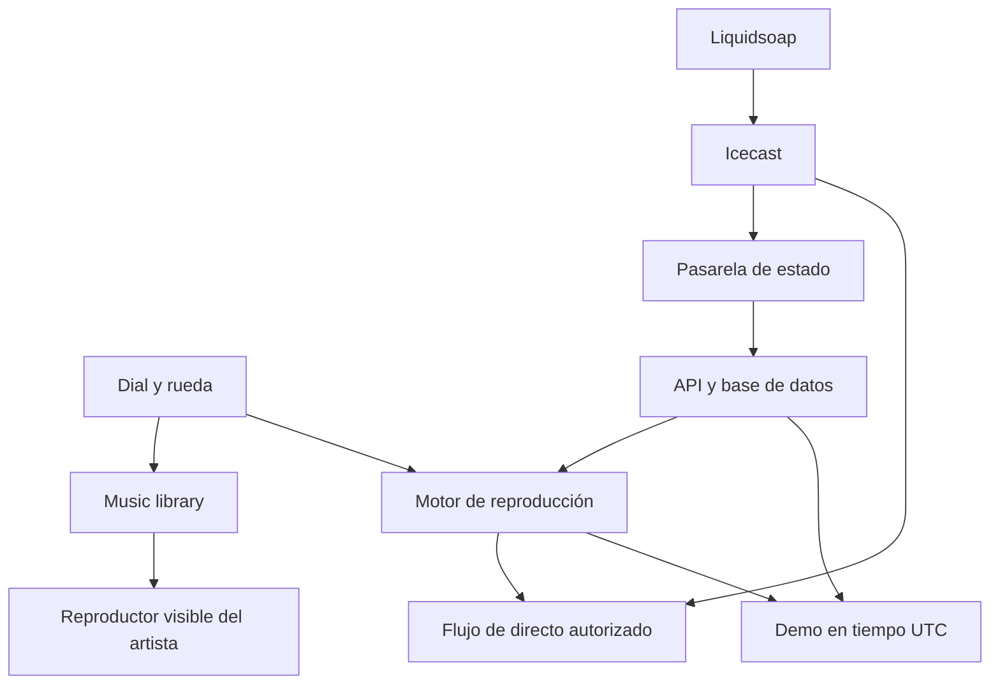

# Arquitectura y diseño

## Del dial al altavoz

La rueda y el dial comparten una sola selección. Cada cambio invalida la generación del reproductor anterior, cancela temporizadores, desconecta nodos Web Audio y destruye su elemento multimedia. La selección explícita abre el nuevo recurso. El volumen y el mute se aplican al crear el elemento. Si el navegador rechaza autoplay, el reproductor vuelve a esperar un gesto.

Para la demo, cada estación cuenta con dos segmentos de duración medida y un desplazamiento determinista respecto a una época UTC. El servidor y el navegador ejecutan la misma función. El reloj se corrige con el punto medio de la petición a la API y se resincroniza tras volver a la pestaña. Al reanudar, se calcula de nuevo la posición de la parrilla. La emisión Icecast tiene su propio origen continuo. Los búferes de los clientes producen diferencias entre dispositivos.

## Persistencia y funcionamiento degradado

SQLite guarda una revisión por estación. El cuerpo contiene datos editoriales, evidencia, fuentes y programas. Índices por orden y vistas SQL permiten consultar esos datos. Una edición concurrente usa el número de revisión. El seed detecta los registros editados y los conserva. Los valores públicos no incluyen credenciales. D1 reutiliza el contrato SQL con sentencias preparadas y migraciones antes del arranque.

El navegador recibe por HTTP el catálogo público y una instantánea de las fuentes. SSE anuncia cambios en selección programada, revisiones y directo. La carga inicial incluye los datos revisados de distribución para que el dial se pueda dibujar antes de recibir la red. La PWA conserva la interfaz y el arte. Los streams, recursos parciales de audio y sesiones administrativas quedan fuera de esa caché.

## Interacción y diseño

La portada sitúa la entrada sobre una ilustración original de una avenida costera al atardecer. La interface usa Barlow Condensed para titulares, DM Sans para lectura e IBM Plex Mono para los datos de señal. Las seis carátulas tienen motivos diferenciados. La carátula, el nombre y el género permiten reconocer la selección sin depender del color.

En el dial radial se divide el círculo en tantos sectores como emisoras. El ángulo se calcula con atan2, con una zona muerta en el centro e histéresis en los límites. La rueda admite teclado, ratón, touch y mando. El diálogo conserva el foco y lo devuelve al control de origen. El dial lineal sigue disponible en todos los tamaños. Solo el analizador conectado al audio propio representa amplitudes de audio. El modo ambiental se identifica por separado.

## Operación y límites

Node integra API y ficheros estáticos, con soporte de rangos para MP3. El build para un Worker incorpora respuestas estáticas con rangos, caché y validadores. El origen Liquidsoap/Icecast corre en un host de streaming independiente. El Worker queda disponible sin ese host para servir la demo y el explorador. La autenticación administrativa exige una base escribible y un secreto del operador.

El tráfico del servicio de audio se dimensiona por tasa de bits y oyentes concurrentes. La memoria y el coste del codificador dependen además del número de canales y del procesamiento. Las pruebas registradas en el repositorio miden cargas concretas. El plan de producción incluye HTTPS, copias verificadas y monitorización de las seis señales.
